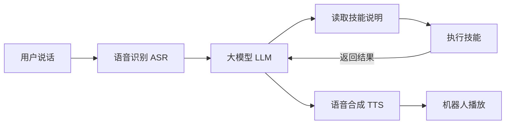

# PrimeBuddy

PrimeBuddy 是一个让机器人通过语音调用技能的 Python 框架。你可以对机器人说“放一首歌”或“打开灯”，由框架识别语音、理解请求，交给相应的 skill 执行，再用语音告诉你结果。

框架负责通用的语音和任务流程，skill 负责具体业务。开发新能力时，通常只需添加技能说明和业务脚本，无需修改框架。当前版本为 **1.0.0**，机器人语音入口适配启元 T1，运行在业务板 SoC 1。

当前提供两个独立 skill，源码在 [PrimeSkills](https://github.com/huang-kai/primeskills)：

| Skill | 能做什么 |
| --- | --- |
| 点歌台 `diangetai` | 登录 QQ 音乐、搜索和播放歌曲、设置播放时长，可选动作、表情和灯光联动 |
| 易来 `yeelight` | 通过 `yeelight-home` 控制灯具，需要另行安装和配置该服务 |

框架包是否附带 skill，由打包时的参数决定。也可以先安装框架，再单独安装所需技能。

## 目录

- [工作原理](#工作原理)
- [安装与使用](#安装与使用)
- [配置与文件位置](#配置与文件位置)
- [部署和管理 skill](#部署和管理-skill)
- [开发一个 skill](#开发一个-skill)
- [打包发布](#打包发布)
- [参与贡献](#参与贡献)
- [开源协议](#开源协议)

## 工作原理

一次语音交互大致经过以下流程：



框架先把可用技能的名称和简介交给大模型。模型需要某项能力时，再读取对应的 `SKILL.md`，执行其中描述的操作。技能的实际执行结果会返回模型，用于组织回复或继续下一步任务。

代码按职责放在 `src/primebuddy/` 下：

| 目录 | 职责 |
| --- | --- |
| `cli/` | 命令行入口和安装、配置向导 |
| `voice/` | 语音会话、录音处理、播放和提示音缓存 |
| `providers/` | 模型服务适配，当前接入千问 |
| `core/` | 任务规划、执行、取消和资源协调 |
| `skills/` | 技能发现、安装、配置和脚本执行 |
| `integrations/t1/` | 对接 T1 的原厂语音、音频和 ROS 2 接口 |
| `config/`、`tools/` | 配置、日志，以及安装、打包等工具 |

语音运行需要机器人环境；技能编写、打包和大部分测试可以在电脑上完成。

## 安装与使用

### 准备环境

机器人运行环境需要 Python 3.10+，以及 T1 已安装的 ROS 2 和原厂消息包。请在 **业务板 SoC 1** 安装、运行框架。

录放音需要 `ffmpeg`，业务板还需要能通过 SSH 访问 SoC 0。首次启动时可能出现板间 SSH 主机确认和登录密码提示。

千问模型调用需要 API Host、API Key 和网络连接。安装向导会引导你填写这些信息，再选择语音识别、对话和语音合成模型。

### 安装框架

从源码安装时，在业务板执行：

```bash
git clone https://github.com/huang-kai/primebuddy.git primebuddy
cd primebuddy

source /robot/etc/basic_env
source /robot/software/housekeeper/bin/setup.bash
source ./scripts/install.sh
```

如果已经拿到 `primebuddy-1.0.0.rpk`，可以用 ZIP 工具解压，再运行同一个安装脚本：

```bash
unzip primebuddy-1.0.0.rpk -d ./primebuddy-release
cd primebuddy-release/primebuddy

source /robot/etc/basic_env
source /robot/software/housekeeper/bin/setup.bash
source ./scripts/install.sh
```

安装脚本会准备 Python 依赖，将程序安装到 `~/.primebuddy`，并让当前终端可以使用 `primebuddy` 命令。首次准备默认日志目录时，可能需要管理员权限。安装完成后，原来的下载或解压目录可以删除。

随后向导会依次完成：

1. 选择模型服务商，填写 API Host 和 API Key。
2. 选择 ASR、LLM、TTS 模型，并按提示验证连接；验证会产生少量 API 调用。
3. 如果框架包附带 skill，选择要安装的技能，完成它们各自的配置。

方向键切换选项，空格多选，回车确认。框架没有附带技能时，稍后按 [部署和管理 skill](#部署和管理-skill) 单独安装即可。

想先安装、稍后配置，可以使用：

```bash
source ./scripts/install.sh --no-onboard
primebuddy onboard
```

### 启动与退出

```bash
primebuddy start
```

启动后，先用机器人的原厂唤醒词唤醒，再提出技能请求；空闲超时后需要重新唤醒。当前语音入口主要用于技能调用和必要的澄清。命令在当前终端前台运行，按 **Ctrl+C** 退出。

启动语音会话时，框架会把原厂 Agent 切换为 `only_voice` 并重启；正常退出时恢复启动前的模式。点歌台的动作联动由技能配置控制，开启后可能产生身体运动，使用前请阅读 [点歌台说明](https://github.com/huang-kai/primeskills/blob/main/diangetai/README.md)。

新开终端后，如果找不到命令，可加载：

```bash
source ~/.primebuddy/bin/env.sh
```

运行语音会话的终端也需要加载上面的原厂环境。

### 更新框架

先按 Ctrl+C 退出正在运行的 PrimeBuddy，再进入新版本的源码或解压目录，重新运行 `source ./scripts/install.sh`。更新会保留实际配置、已安装的技能和登录数据。

### 常用命令

| 命令 | 用途 |
| --- | --- |
| `primebuddy --help` | 查看帮助 |
| `primebuddy --version` | 查看版本 |
| `primebuddy onboard` | 重新进入模型和技能配置向导 |
| `primebuddy start` | 启动机器人语音会话 |
| `primebuddy skill list` | 查看技能及其状态 |
| `primebuddy skill catalog` | 查看大模型当前可以使用的技能 |
| `primebuddy simulate --help` | 查看本地模拟用法 |

其他参数通过对应命令的 `--help` 查看，例如 `primebuddy skill install --help`。

## 配置与文件位置

默认安装目录如下。技能、配置和登录数据会在安装或配置后生成。

```text
~/.primebuddy/
├── main.py                  程序入口
├── README.md                使用说明
├── LICENSE                  MIT 开源协议
├── requirements.txt         框架 Python 依赖
├── bin/                     primebuddy 命令和终端环境脚本
├── src/primebuddy/           框架代码
├── cfg/
│   ├── config.yaml          模型选择、运行目录和日志设置
│   ├── providers.yaml       模型服务的 Host、Key 和候选模型
│   ├── skills.yaml          技能安装和启停记录
│   ├── *.example.yaml       公开配置模板
│   └── skills/<name>/       每个技能的业务配置
├── skills/<name>/           每个技能的代码、资源和依赖
├── data/<name>/             每个技能的私有数据，例如 QQ 登录态
├── runtime/                 会话锁、恢复记录和语音缓存
├── resource/                静态资源及可选的随包技能
├── _deps/                   框架需要额外安装的 Python 依赖
└── scripts/                 安装和开发脚本
```

日志默认保存在 `/var/log/primebuddy/primebuddy.log`。需要自定义安装位置时，使用 `source ./scripts/install.sh --home /你的安装目录`，下文的默认路径也应相应替换。

日常配置主要修改这三个位置：

| 想修改什么 | 文件 |
| --- | --- |
| 当前使用的模型、TTS 音色、日志设置 | `~/.primebuddy/cfg/config.yaml` |
| 模型服务的 API Host、API Key、候选模型 | `~/.primebuddy/cfg/providers.yaml` |
| 某个技能的业务设置 | `~/.primebuddy/cfg/skills/<name>/config.yaml`，也可运行 `skill configure` |

模型使用 `provider:model` 表示，例如：

```yaml
# cfg/config.yaml 中的模型部分
asr:
  model: "qianwen:qwen3-asr-flash"
llm:
  model: "qianwen:qwen-plus"
tts:
  model: "qianwen:qwen-audio-3.0-tts-plus"
  tts_voice: longanlingxin
```

对应的服务连接信息放在 `providers.yaml`：

```yaml
qianwen:
  api_host: dashscope.aliyuncs.com
  api_key: "填写自己的 API Key"
  models:
    asr: [qwen3-asr-flash]
    llm: [qwen-plus]
    tts: [qwen-audio-3.0-tts-plus]
```

`models` 是安装向导的候选列表。增加新的 provider 还需要在 `providers/` 中实现调用适配；只填写一个新名字不会自动接入服务。

手工修改后，重新启动语音会话生效。`*.example.yaml` 是公开模板，日常使用修改实际配置文件即可。真实 API Key 和登录数据不要提交到代码仓库或放进发布包。

## 部署和管理 skill

### 安装技能

把技能的 RPK 上传到机器上，在包所在目录执行：

```bash
primebuddy skill install ./diangetai-0.3.0.rpk
```

也可以安装本地的单个技能源码目录：

```bash
primebuddy skill install ./primebuddy-skills/diangetai
```

目录中应有 `SKILL.md`，不能把包含多个技能的集合根目录当成一个技能安装。安装器会复制文件、安装声明的 Python 依赖，并调用技能自己的配置向导。无需配置的技能安装后直接启用。

RPK 使用 ZIP 格式，旧 ZIP 包也支持；还可以传入 HTTPS 包下载地址，或根目录包含 `SKILL.md` 的单技能 Git 仓库地址。

需要以后再配置时：

```bash
primebuddy skill install ./diangetai-0.3.0.rpk --no-configure
primebuddy skill configure diangetai
```

### 更新、配置和停用

```bash
# 更新已有技能
primebuddy skill install ./diangetai-0.3.0.rpk --replace

# 重新配置
primebuddy skill configure diangetai

# 暂时停用，保留代码、配置和登录态
primebuddy skill disable diangetai

# 重新启用
primebuddy skill enable diangetai
```

安装、更新、配置或启停后，重新启动语音会话，让框架重新加载技能。

### 删除技能

当前版本还没有 `skill uninstall` 命令，需要手动删除。以删除 `hello` 为例：

1. 按 Ctrl+C 退出正在运行的 PrimeBuddy。
2. 用 `primebuddy skill list` 确认 `hello` 的实际目录。在 `~/.primebuddy/cfg/skills.yaml` 中删除整个 `hello:` 条目，包括其下面缩进的内容；如果没有这个条目，跳过此步。
3. 删除技能代码目录。默认安装位置使用下面的命令；如果列表显示的是其他目录，以实际位置为准。

```bash
rm -rf ~/.primebuddy/skills/hello
primebuddy skill list
```

删除代码后，原来的配置和登录数据仍会保留。如果也要彻底清除该技能的数据，再执行：

```bash
rm -rf ~/.primebuddy/cfg/skills/hello ~/.primebuddy/data/hello
```

清除数据后重新安装，需要重新配置和登录。如果只是暂时不用，使用 `skill disable` 即可。

## 开发一个 skill

一个 skill 最少只需要一个 `SKILL.md`。它告诉框架：这个技能叫什么、什么时候使用，以及如何完成任务。需要执行业务操作时再加脚本，需要第三方库时再加依赖。

下面的例子在框架源码目录中操作，技能放在相邻的 `my-skills/hello/`。

### 1. 编写技能说明

创建目录：

```bash
mkdir -p ../my-skills/hello
```

在 `../my-skills/hello/SKILL.md` 中写入：

```markdown
---
name: hello
description: 用户要求向某个人问好时使用。
metadata:
  version: "0.1.0"
---

没有提供名字时，先询问名字。
用户提供名字后，用一句简短中文问候。
```

`name` 使用小写字母、数字和连字符，`description` 写清用途和触发条件。只提供说明的技能，到这里就可以安装。

### 2. 按需添加业务代码

如果任务需要运行代码，可以增加 `src/greet.py`：

```text
hello/
├── SKILL.md
└── src/
    └── greet.py
```

```python
import argparse

parser = argparse.ArgumentParser()
parser.add_argument('name')
args = parser.parse_args()
print('你好，' + args.name)
```

同时把 `SKILL.md` 正文改为：

```text
没有提供名字时，先询问名字。
运行 src/greet.py，将名字作为一个命令行参数。
根据脚本的实际输出回复用户。
```

脚本可以使用 Python、Bash 或 JavaScript，不必导入 PrimeBuddy。业务执行时通过参数接收输入，通过标准输出返回结果；不要在业务脚本中用 `input()` 等待交互。安装时的交互配置使用下方的配置向导。

只用 Python 标准库时无需额外依赖。需要第三方库时，在技能根目录的 `requirements.txt` 中使用 `包名==版本号` 声明，安装器会将依赖放到技能自己的 `_deps/`。

<details>
<summary>技能需要安装配置向导时</summary>

增加 `cfg/pkg.yaml`，保存包信息并声明配置入口：

```yaml
package_name: hello
version: "0.1.0"
user_id: robot_local
author: "你的名字"
description: "问候技能"
sdk_version: "v1.0.0"
primebuddy:
  setup: src/setup.py
```

`package_name` 必须与 `SKILL.md` 中的 `name` 相同。`sdk_version` 记录开发参考版本，不会要求普通技能安装机器人 SDK。

在 `src/setup.py` 中实现：

```python
def setup(ui, data_dir, config):
    greeting = ui.ask('问候用语', config.get('greeting', '你好'))
    return {**config, 'greeting': greeting}
```

框架会在安装时调用这个函数，将返回的字典保存到 `~/.primebuddy/cfg/skills/hello/config.yaml`。重新运行 `primebuddy skill configure hello` 会调用同一向导。

业务脚本可通过环境变量 `PRIMEBUDDY_SKILL_CONFIG` 获取配置文件路径，通过 `PRIMEBUDDY_SKILL_DATA` 获取私有数据目录。账号和登录态保存在数据目录中。

如果已有独立的交互配置脚本，也可以用 `configure: [src/configure.py]` 代替 `setup`；两种入口选择一种即可。

</details>

<details>
<summary>技能需要共享框架音频或任务取消功能时</summary>

可以使用原生工具适配，在 `cfg/pkg.yaml` 中声明具名函数：

```yaml
primebuddy:
  entrypoint: src/actions.py
  actions:
    greet:
      parameters:
        name: {type: string}
      resources: []
```

`src/actions.py`：

```python
def greet(context, name):
    context.checkpoint()
    return '你好，' + name
```

框架会用 `greet(context=context, name=...)` 调用业务函数。长任务可通过 `context.checkpoint()` 响应取消，播放音频可使用 `context.audio`。实现示例见 [点歌台源码](https://github.com/huang-kai/primeskills/blob/main/diangetai/src/skill.py)。

</details>

### 3. 验证并安装

添加脚本后，先直接运行，确认业务结果：

```bash
python3 ../my-skills/hello/src/greet.py 张三
```

再安装到框架，检查是否被发现：

```bash
primebuddy skill install ../my-skills/hello
primebuddy skill list
primebuddy skill catalog
```

已经配置模型时，还可以用文字模拟一次请求：

```bash
primebuddy simulate --skills-dir ../my-skills --text "向张三问好"
```

文字模拟会调用 LLM，用来检查模型是否选中技能、读取说明并生成任务；不会实际执行业务脚本或控制设备。真实设备能力仍需要在相应环境中验证。

在技能的 `tests/` 中保留主要功能、错误输入和业务失败的测试。涉及长任务时，也要检查取消和清理逻辑。

### 4. 打包和部署

```bash
python3 src/primebuddy/tools/build_release.py --skill ../my-skills/hello
```

生成的包是 `dist/hello-0.1.0.rpk`。把它复制到已安装 PrimeBuddy 的机器上，再使用 `primebuddy skill install` 安装。更新已有技能时增加 `--replace`。

## 打包发布

所有打包命令都在框架源码目录执行。直接运行脚本会显示帮助：

```bash
python3 src/primebuddy/tools/build_release.py
```

只打框架：

```bash
python3 src/primebuddy/tools/build_release.py --framework
```

只打指定技能：

```bash
python3 src/primebuddy/tools/build_release.py --skill ../primebuddy-skills/diangetai
```

将技能一起放进框架包，每个技能单独写一个 `--skill`：

```bash
python3 src/primebuddy/tools/build_release.py --framework \
  --skill ../primebuddy-skills/diangetai \
  --skill ../primebuddy-skills/yeelight
```

只有显式指定的技能才会进入框架包。组合打包时，也会输出每个技能的独立 RPK。`--skill` 接受源码目录，已有 RPK 直接安装或发布即可。

包默认输出到框架 `dist/`，名称为 `项目名-版本号.rpk`，例如 `primebuddy-1.0.0.rpk`。内容是 ZIP，打包工具会生成 ZIP 后改为 RPK 后缀，可用于分发或准备启元 SkillHub 发布包。

框架版本来自 `src/primebuddy/__init__.py`，技能版本来自 `cfg/pkg.yaml`；没有该文件时，使用 `SKILL.md` 中的 `metadata.version`，未声明版本时为 `0.0.0`。发布前请更新对应版本。

`--output-dir 目录` 可以指定输出位置。修改源码后需要重打同版本包时增加 `--overwrite`；默认不会覆盖已有同名包。测试文件、开发文档、实际框架配置和运行数据不会进入发布包；技能作者应把私有配置和登录态保存在框架的数据目录中。

## 参与贡献

欢迎修复问题、改进文档或开发新技能。框架代码提交到 [PrimeBuddy](https://github.com/huang-kai/primebuddy)，现有两个技能的改动提交到 [PrimeSkills](https://github.com/huang-kai/primeskills)。

1. 在相应仓库创建 Issue，说明问题或想增加的功能。小的文档修正可以直接提交 PR。
2. Fork 仓库，在自己的分支上修改，尽量让一个 PR 解决一个问题。
3. 运行相关测试。行为变化应补充主要用例，文档改动应核对命令和路径。
4. 向仓库的 `main` 分支提交 PR，说明解决了什么问题、怎么修改，以及实际做了哪些验证。

在电脑上准备框架开发环境：

```bash
python3 -m venv .venv
source .venv/bin/activate
python3 -m pip install -r requirements.txt
bash scripts/test.sh
```

测试脚本会运行框架测试；如果相邻目录有 `primebuddy-skills`，也会运行各个技能的测试。测试不要求连接真实机器人，缺少原厂 SDK 的相关夹具会明确跳过。

源码目录中，`cfg/` 放公开配置模板，`src/` 放代码，`resource/` 放正式资源，`tests/` 放主要测试，`scripts/` 放安装和开发脚本。`docs/` 暂时只作为本地开发资料，不提交 Git。测试录音、生成的发布包、API Key 和账号登录态也不提交。

报告问题时，请附上版本、复现步骤和必要的日志，隐去密钥和账号信息。涉及机器人运动的验证，应单独说明测试环境和安全条件。

## 开源协议

PrimeBuddy 框架采用 [MIT 协议](LICENSE)。分发源码或框架包时，请保留版权和许可声明。独立技能及第三方依赖遵循各自的协议。
