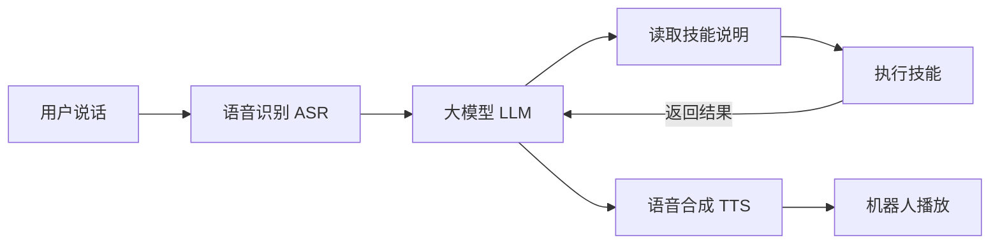

# PrimeBuddy

PrimeBuddy 是一个让机器人通过语音调用技能的 Python 框架。你可以对机器人说“放一首歌”或“打开灯”，由框架识别语音、理解请求，交给相应的 skill 执行，再用语音告诉你结果。

框架负责通用的语音和任务流程，skill 负责具体业务。开发新能力时，通常只需添加技能说明和业务脚本，无需修改框架。当前版本为 **1.0.0**，启动时识别启元 T1/Q1，只适配框架自身的原厂语音前端和播报。技能独立使用设备接口，不依赖框架播放器。

当前提供两个独立 skill，源码在 [PrimeSkills](https://github.com/huang-kai/primeskills)：

| Skill | 能做什么 |
| --- | --- |
| 点歌台 `diangetai` | 登录 QQ 音乐、搜索和播放歌曲、设置播放时长，可选动作、表情和灯光联动 |
| 易来 `yeelight` | 通过 `yeelight-home` 控制灯具，需要另行安装和配置该服务 |

框架包是否附带 skill，由打包时的参数决定。也可以先安装框架，再单独安装所需技能。

## 目录

- [工作原理](#工作原理)
- [安装与使用](#安装与使用)
- [配置与文件位置](#配置与文件位置)
- [部署和管理 skill](#部署和管理-skill)
- [开发一个 skill](#开发一个-skill)
- [打包发布](#打包发布)
- [参与贡献](#参与贡献)
- [开源协议](#开源协议)

## 工作原理

一次语音交互大致经过以下流程：



框架先把可用技能的名称和简介交给大模型。模型需要某项能力时，再读取对应的 `SKILL.md`，执行其中描述的操作。技能的实际执行结果会返回模型，用于组织回复或继续下一步任务。

代码按职责放在 `src/primebuddy/` 下：

| 目录 | 职责 |
| --- | --- |
| `cli/` | 命令行入口和安装、配置向导 |
| `voice/` | 语音会话、录音处理、播放和提示音缓存 |
| `providers/` | 模型服务适配，当前接入千问 |
| `core/` | 任务规划、执行、取消和资源协调 |
| `skills/` | 技能发现、安装、配置和脚本执行 |
| `integrations/primebot/` | T1/Q1 身份识别、框架自身语音和原厂 Agent 管理 |
| `config/`、`tools/` | 配置、日志，以及安装、打包等工具 |

语音运行需要机器人环境；技能编写、打包和大部分测试可以在电脑上完成。

## 安装与使用

### 准备环境

机器人运行环境需要系统 Python 3.10+、ROS 2 和目标设备已安装的原厂消息包。框架读取 `/robot/data/info/series` 识别 T1/Q1；SoC 0 统一称为运控板，SoC 1 称为大脑板。未知型号明确拒绝启动，不覆盖原厂消息包。

语音服务与应用同机时直接调用，不需要 SSH。默认使用运控板的语音服务：部署于运控板采用本地路径，部署于大脑板使用 `run@10.1.1.100`；可用 `PRIMEBOT_AUDIO_HOST=local` 或 `PRIMEBOT_AUDIO_HOST=user@host` 显式指定服务主机。向导自动检查并配置跨板 SSH，供 Agent 管理和音频文件传输使用；不会假设跨板共享文件。

千问模型调用需要 API Host、API Key 和网络连接。安装向导会引导你填写这些信息，再选择语音识别、对话和语音合成模型。

### 安装框架

从源码安装时，在机器人当前登录的板上执行：

```bash
git clone https://github.com/huang-kai/primebuddy.git primebuddy
cd primebuddy

source ./scripts/install.sh
```

如果已经拿到 `primebuddy-1.0.0.rpk`，可以用 ZIP 工具解压，再运行同一个安装脚本：

```bash
unzip primebuddy-1.0.0.rpk -d ./primebuddy-release
cd primebuddy-release/primebuddy

source ./scripts/install.sh
```

安装器自动选择位置，T1 和 Q1 使用相同规则，无需选择板型：

- 当前在大脑板：直接安装。
- 当前在运控板：探测固定地址 `10.1.1.101:22`，最多尝试三次，每次连接超时两秒。可达时自动连接大脑板、核对身份并传输安装包，后续安装和向导均在大脑板完成。
- 始终未探测到大脑板：在运控板本地安装。单板 Q1 使用这一流程，不配置跨板 SSH。

这里以固定内网地址作为安装约定；大脑板关闭或 SSH 不可达时也会走本板流程。端口可达后的密码错误、身份不符或传输失败会停止安装，不会退回运控板继续。已有安装更新时保留目标板配置、技能和数据；跨板只传输安装包，不搬迁运控板上的旧账号或私有配置。

程序安装到目标板的 `~/.primebuddy`，自动准备 Python 依赖和命令入口。首次准备默认日志目录时，可能需要管理员权限。跨板交互安装完成后，终端留在大脑板，可直接运行 `primebuddy start`；输入 `exit` 返回运控板，下次可从运控板执行 `ssh -t run@10.1.1.101` 再进入大脑板。原来的下载或解压目录可以删除。

随后向导会依次完成：

1. 自动检查原厂语音连接。本板服务直接查询；跨板连接优先复用已有免密认证，必要时由 SSH 提示输入运控板登录密码，程序不保存密码。
2. 选择模型服务商，填写 API Host 和 API Key，选择 ASR、LLM、TTS 模型并验证连接；验证会产生少量 API 调用。
3. 如果框架包附带 skill，选择要安装的技能，完成它们各自的配置。

需要新授权时，向导在大脑板的 `~/.ssh/primebuddy/` 生成专用密钥，只向运控板追加公钥，并在本机 `~/.ssh/config` 中加入对应地址的密钥配置，供框架和独立技能共用。若原厂镜像将当前用户的 `~/.ssh` 设为 root 所有且不可写，安装器会请求管理员权限，只调整该目录本身的所有者和权限，保留里面已有文件。私钥不传输，不覆盖已有用户密钥，更新时保留。首次连接记录主机公钥，主机公钥改变时 SSH 会拒绝连接。已有认证通过时不会生成新密钥。

从运控板开始双板安装时，可能分别提示“大脑板登录”和“运控板语音连接”的密码。向导通过一次不复用临时会话的连接验证免密认证，并只读查询原厂 Agent 状态；安装不启停 Agent、不切换语音模式。中断后在目标板运行 `primebuddy onboard` 可继续；连接未完成时不会提前进入模型和技能配置。

方向键切换选项，空格多选，回车确认。框架没有附带技能时，稍后按 [部署和管理 skill](#部署和管理-skill) 单独安装即可。

想先安装、稍后配置，可以使用：

```bash
source ./scripts/install.sh --no-onboard
primebuddy onboard
```

### 启动与退出

```bash
primebuddy start
```

启动后，先用机器人的原厂唤醒词唤醒，再提出技能请求；空闲超时后需要重新唤醒。当前语音入口主要用于技能调用和必要的澄清。命令在当前终端前台运行，按 **Ctrl+C** 退出。

启动时先检查技能遗留的播放和资源记录，未确认释放就不播放启动提示。启动提示结束后等待原厂开放监听，唤醒识别和唤醒应答由原厂 Agent 负责；框架只识别业务语音并播报业务结果。目前未验证到可明确表示原厂唤醒的通知，自动语音打断暂不可用，框架不根据 ASR 文本、会话状态转换或 VAD 开始帧取消任务。任务仍受运行超时、取消信号和进程清理保护；无法确认设备资源已释放时退出语音会话，不继续播放。歌曲正常结束后仍会打开 30 秒接话窗口，可直接提出下一个请求。

原厂处于 SPEAKING 状态时，Buddy 不接收监听音频，并清除跨过该播报的不完整片段；恢复监听后须有新的完整 VAD 语句。空闲收音超时后等待新的原厂监听转换，缓存或重复的 LISTENING 状态不会立即重开窗口。业务提示音真实结束后的接话窗口保持原有行为。

ASR、对话模型、TTS 或点歌取流发生明确的连接失败、DNS 故障或超时时，播放原厂 `check_internet` 网络提示音。音频随包提供，不依赖云端合成、已有缓存或原厂资源的安装路径；持续故障时 60 秒内最多播报一次，并停止本轮后续云端调用。密钥、权限、配额和歌曲资源拒绝仍按各自错误处理。无法确认扬声器已释放时不抢占播放；唤醒职责保持由原厂 Agent 管理。资源来源及格式见 [提示音说明](resource/voice/README.md)。

启动语音会话时，框架会把原厂 Agent 切换为 `only_voice` 并重启；正常退出时恢复启动前的模式。管理工具优先探测 yamo，缺失时采用已核对的 HTTP 入口；写请求失败或超时不会切换后端重发。恢复记录绑定型号、SKU 和服务主机，旧格式或目标不匹配时保留记录并拒绝接管。点歌台的动作联动由技能配置控制，开启后可能产生身体运动，使用前请阅读 [点歌台说明](https://github.com/huang-kai/primeskills/blob/main/diangetai/README.md)。

新开终端后，如果找不到命令，可加载：

```bash
source ~/.primebuddy/bin/env.sh
```

安装后的 `primebuddy` 入口会按 T1/Q1 自动加载对应的原厂 ROS 环境，新终端无需再次手动加载。双板用户应在大脑板运行命令；运控板上的安装入口不会注册第二份 Buddy。

### 更新框架

先按 Ctrl+C 退出正在运行的 PrimeBuddy，再进入新版本的源码或解压目录，重新运行 `source ./scripts/install.sh`。更新会保留实际配置、已安装的技能和登录数据。

### 常用命令

| 命令 | 用途 |
| --- | --- |
| `primebuddy --help` | 查看帮助 |
| `primebuddy --version` | 查看版本 |
| `primebuddy onboard` | 检查机器人连接，继续模型和技能配置 |
| `primebuddy start` | 启动机器人语音会话 |
| `primebuddy skill list` | 查看技能及其状态 |
| `primebuddy skill catalog` | 查看大模型当前可以使用的技能 |
| `primebuddy simulate --help` | 查看本地模拟用法 |

其他参数通过对应命令的 `--help` 查看，例如 `primebuddy skill install --help`。

## 配置与文件位置

默认安装目录如下。技能、配置和登录数据会在安装或配置后生成。

```text
~/.primebuddy/
├── main.py                  程序入口
├── README.md                使用说明
├── LICENSE                  MIT 开源协议
├── requirements.txt         框架 Python 依赖
├── bin/                     primebuddy 命令和终端环境脚本
├── src/primebuddy/           框架代码
├── cfg/
│   ├── config.yaml          模型选择、运行目录和日志设置
│   ├── providers.yaml       模型服务的 Host、Key 和候选模型
│   ├── skills.yaml          技能安装和启停记录
│   ├── *.example.yaml       公开配置模板
│   └── skills/<name>/       每个技能的业务配置
├── skills/<name>/           每个技能的代码、资源和依赖
├── data/<name>/             每个技能的私有数据，例如 QQ 登录态
├── runtime/                 会话锁、恢复记录和语音缓存
├── resource/                静态资源及可选的随包技能
├── _deps/                   框架需要额外安装的 Python 依赖
└── scripts/                 安装和开发脚本
```

日志默认保存在 `/var/log/primebuddy/primebuddy.log`。需要自定义安装位置时，使用 `source ./scripts/install.sh --home /你的安装目录`，下文的默认路径也应相应替换。

日常配置主要修改这三个位置：

| 想修改什么 | 文件 |
| --- | --- |
| 当前使用的模型、TTS 音色、日志设置 | `~/.primebuddy/cfg/config.yaml` |
| 模型服务的 API Host、API Key、候选模型 | `~/.primebuddy/cfg/providers.yaml` |
| 某个技能的业务设置 | `~/.primebuddy/cfg/skills/<name>/config.yaml`，也可运行 `skill configure` |

模型使用 `provider:model` 表示，例如：

```yaml
# cfg/config.yaml 中的模型部分
asr:
  model: "qianwen:qwen3-asr-flash"
llm:
  model: "qianwen:qwen-plus"
tts:
  model: "qianwen:qwen-audio-3.0-tts-plus"
  tts_voice: longanlingxin
```

对应的服务连接信息放在 `providers.yaml`：

```yaml
qianwen:
  api_host: dashscope.aliyuncs.com
  api_key: "填写自己的 API Key"
  models:
    asr: [qwen3-asr-flash]
    llm: [qwen-plus]
    tts: [qwen-audio-3.0-tts-plus]
```

`models` 是安装向导的候选列表。增加新的 provider 还需要在 `providers/` 中实现调用适配；只填写一个新名字不会自动接入服务。

手工修改后，重新启动语音会话生效。`*.example.yaml` 是公开模板，日常使用修改实际配置文件即可。真实 API Key 和登录数据不要提交到代码仓库或放进发布包。

## 部署和管理 skill

### 安装技能

把技能的 RPK 上传到机器上，在包所在目录执行：

```bash
primebuddy skill install ./diangetai-0.3.0.rpk
```

也可以安装本地的单个技能源码目录：

```bash
primebuddy skill install ./primebuddy-skills/diangetai
```

目录中应有 `SKILL.md`，不能把包含多个技能的集合根目录当成一个技能安装。安装器会复制文件、安装声明的 Python 依赖，并调用技能自己的配置向导。无需配置的技能安装后直接启用。

RPK 使用 ZIP 格式，旧 ZIP 包也支持；还可以传入 HTTPS 包下载地址，或根目录包含 `SKILL.md` 的单技能 Git 仓库地址。

需要以后再配置时：

```bash
primebuddy skill install ./diangetai-0.3.0.rpk --no-configure
primebuddy skill configure diangetai
```

### 更新、配置和停用

```bash
# 更新已有技能
primebuddy skill install ./diangetai-0.3.0.rpk --replace

# 重新配置
primebuddy skill configure diangetai

# 暂时停用，保留代码、配置和登录态
primebuddy skill disable diangetai

# 重新启用
primebuddy skill enable diangetai
```

安装、更新、配置或启停后，重新启动语音会话，让框架重新加载技能。

### 删除技能

当前版本还没有 `skill uninstall` 命令，需要手动删除。以删除 `hello` 为例：

1. 按 Ctrl+C 退出正在运行的 PrimeBuddy。
2. 用 `primebuddy skill list` 确认 `hello` 的实际目录。在 `~/.primebuddy/cfg/skills.yaml` 中删除整个 `hello:` 条目，包括其下面缩进的内容；如果没有这个条目，跳过此步。
3. 删除技能代码目录。默认安装位置使用下面的命令；如果列表显示的是其他目录，以实际位置为准。

```bash
rm -rf ~/.primebuddy/skills/hello
primebuddy skill list
```

删除代码后，原来的配置和登录数据仍会保留。如果也要彻底清除该技能的数据，再执行：

```bash
rm -rf ~/.primebuddy/cfg/skills/hello ~/.primebuddy/data/hello
```

清除数据后重新安装，需要重新配置和登录。如果只是暂时不用，使用 `skill disable` 即可。

## 开发一个 skill

一个 skill 最少只需要一个 `SKILL.md`。它告诉框架：这个技能叫什么、什么时候使用，以及如何完成任务。需要执行业务操作时再加脚本，需要第三方库时再加依赖。

可以复制技能仓库的 [通用模板](https://github.com/huang-kai/primeskills/blob/main/templates/my-skill/SKILL.md)，并参考 [编写指南](https://github.com/huang-kai/primeskills/blob/main/templates/README.md)。目录采用常见的 `SKILL.md` 加可选 `scripts/`、`references/`、`assets/`；已有程序也可以保留自己的 `main.py`、`src/` 结构。

发现技能时，模型只看到名称、简短 `description` 和位置；选中后读取完整正文，再按需读参考资料。摘要简短是为了控制发现成本，正文仍需写清使用步骤、例子、结果校验和失败处理。不要求每个技能实现 `run(context)` 等宿主函数。

下面的例子在框架源码目录中操作，技能放在相邻的 `my-skills/hello/`。

### 1. 编写技能说明

创建目录：

```bash
mkdir -p ../my-skills/hello
```

在 `../my-skills/hello/SKILL.md` 中写入：

```markdown
---
name: hello
description: 用户要求向某个人问好时使用。
metadata:
  version: "0.1.0"
---

没有提供名字时，先询问名字。
用户提供名字后，用一句简短中文问候。
```

`name` 使用小写字母、数字和单连字符，最多 64 字符，并与目录名一致；`description` 最多 1024 字符，写清用途和触发条件。较复杂的正文可按“何时使用、准备、执行流程、校验与反馈、失败与取消、示例、参考”组织，按业务删除无关章节。只提供说明的技能，到这里就可以安装。

### 2. 按需添加业务代码

如果任务需要运行代码，可以增加 `scripts/greet.py`：

```text
hello/
├── SKILL.md
└── scripts/
    └── greet.py
```

```python
import argparse

parser = argparse.ArgumentParser()
parser.add_argument('name')
args = parser.parse_args()
print('你好，' + args.name)
```

同时把 `SKILL.md` 正文改为：

```text
没有提供名字时，先询问名字。
运行 scripts/greet.py，将名字作为一个命令行参数。
根据脚本的实际输出回复用户。
```

脚本可以使用 Python、Bash 或 JavaScript，不必导入 PrimeBuddy。业务执行时通过参数接收输入，通过标准输出返回结果；不要在业务脚本中用 `input()` 等待交互。安装时的交互配置使用下方的配置向导。

普通文本输出即可，不强制某种 JSON 结构。长任务可以处理标准终止信号或提供自己的停止命令，不需要为 Buddy 增加 `cancel(context)`、`shutdown(context)`。设备操作的停止与清理仍由业务程序负责，进程结束本身不代表机器人已停止。

只用 Python 标准库时无需额外依赖。需要第三方库时，在技能根目录的 `requirements.txt` 中使用 `包名==版本号` 声明，安装器会将依赖放到技能自己的 `_deps/`。

### 可选：由 Buddy 配置 CLI 调用

普通脚本只需在 `SKILL.md` 写清命令。需要具名动作、参数校验、资源互斥或更具体的硬超时时，在 **Buddy 的** `~/.primebuddy/cfg/skill-adapters.yaml` 添加可选映射，例如：

```yaml
hello:
  actions:
    greet:
      command: [scripts/greet.py, '{name}']
      parameters:
        name: {type: string}
      resources: []
      timeout_seconds: 30
      description: 正在问候 {name}
```

`command` 是技能内脚本和参数列表，不是 shell 字符串。模板只替换已声明参数和 `{config}`、`{data}`、`{runtime}`；模型不能改脚本入口、资源或执行期限。未适配的通用脚本默认共用 `skill.scripts`，硬期限为 600 秒。已适配的技能只暴露声明动作，避免从原始脚本入口绕过资源和清理约束。

点歌台和易来的默认映射见 [skill-adapters.example.yaml](cfg/skill-adapters.example.yaml)。用户配置按技能名称替换默认条目，值设为 `null` 可禁用该适配。`configure` 可映射技能自己的交互式配置命令；`context`、动作的 `preflight`、`confirmation` 可映射已有的只读查询或预览命令。它们都是可选 CLI 用法，不要求技能实现同名 Python 函数。配置与登录只在 Console 进行。

设备程序应自行处理标准终止信号和原厂业务收尾。对需要确认外部设备释放的技能，可以配置 `status` 和 `recover` 命令：前者返回实际状态，后者执行技能自身提供的恢复操作。Buddy 仅在状态查询返回 `status: success`、`resources_released: true` 后解除隔离；查询失败、超时或无法确认均保留私有记录，阻止占用相关资源。普通文本 CLI 不需要使用这组可选 JSON 字段。

旧包的 `entrypoint/actions` 和可选 hooks 继续通过一次性 worker 子进程兼容，业务模块不再导入 Buddy 主进程；它们仍属于旧宿主协议，且同样只暴露已声明动作。新的点歌台和易来已迁移普通 CLI，不采用这条路径。

### 进程期限与取消

每次执行有独立进程组、任务和所属轮次 ID，以及私有输出文件和执行记录。硬期限届满或本轮取消时，监督器依次发送 SIGINT、SIGTERM、SIGKILL，默认宽限分别为 3、2、2 秒，并核对进程清理结果。点歌适配将首段宽限设为 25 秒，容纳订阅匹配、原厂停止请求与状态确认；可通过宿主动作的 `stop_grace_seconds` 配置三段有界宽限。技能无需实现 Buddy 的取消函数。当前会追踪已观察到的后代，包括另建进程组的子进程；首次采样前瞬间脱离父子关系的进程仍有边界，当前没有 cgroup/subreaper 隔离或重启接管保证。

进程退出与机器人业务结束分别确认。点歌正常完成等待原厂 `PlayMediaFile` 的播放生命周期；取消或异常后检查技能自身恢复记录，必要时调用它的恢复命令。设备清理未确认时，语音会话退出且不播报、不启动新任务；启动首次播报前也会检查遗留状态。执行记录用于审计，不会自动重放上一次命令。

### 3. 验证并安装

添加脚本后，先直接运行，确认业务结果：

```bash
python3 ../my-skills/hello/scripts/greet.py 张三
```

再安装到框架，检查是否被发现：

```bash
primebuddy skill install ../my-skills/hello
primebuddy skill list
primebuddy skill catalog
```

已经配置模型时，还可以用文字模拟一次请求：

```bash
primebuddy simulate --skills-dir ../my-skills --text "向张三问好"
```

文字模拟会调用 LLM，用来检查模型是否选中技能、读取说明并生成任务；不会实际执行业务脚本或控制设备。真实设备能力仍需要在相应环境中验证。

在技能的 `tests/` 中保留主要功能、错误输入和业务失败的测试。涉及长任务时，也要检查取消和清理逻辑。

### 4. 打包和部署

```bash
python3 src/primebuddy/tools/build_release.py --skill ../my-skills/hello
```

生成的包是 `dist/hello-0.1.0.rpk`。把它复制到已安装 PrimeBuddy 的机器上，再使用 `primebuddy skill install` 安装。更新已有技能时增加 `--replace`。

## 打包发布

所有打包命令都在框架源码目录执行。直接运行脚本会显示帮助：

```bash
python3 src/primebuddy/tools/build_release.py
```

只打框架：

```bash
python3 src/primebuddy/tools/build_release.py --framework
```

只打指定技能：

```bash
python3 src/primebuddy/tools/build_release.py --skill ../primebuddy-skills/diangetai
```

将技能一起放进框架包，每个技能单独写一个 `--skill`：

```bash
python3 src/primebuddy/tools/build_release.py --framework \
  --skill ../primebuddy-skills/diangetai \
  --skill ../primebuddy-skills/yeelight
```

只有显式指定的技能才会进入框架包。组合打包时，也会输出每个技能的独立 RPK。`--skill` 接受源码目录，已有 RPK 直接安装或发布即可。

包默认输出到框架 `dist/`，名称为 `项目名-版本号.rpk`，例如 `primebuddy-1.0.0.rpk`。内容是 ZIP，打包工具会生成 ZIP 后改为 RPK 后缀，可用于分发或准备启元 SkillHub 发布包。

框架版本来自 `src/primebuddy/__init__.py`，技能版本来自 `cfg/pkg.yaml`；没有该文件时，使用 `SKILL.md` 中的 `metadata.version`，未声明版本时为 `0.0.0`。发布前请更新对应版本。

`--output-dir 目录` 可以指定输出位置。修改源码后需要重打同版本包时增加 `--overwrite`；默认不会覆盖已有同名包。测试文件、开发文档、实际框架配置和运行数据不会进入发布包；技能作者应把私有配置和登录态保存在框架的数据目录中。

## 参与贡献

欢迎修复问题、改进文档或开发新技能。框架代码提交到 [PrimeBuddy](https://github.com/huang-kai/primebuddy)，现有两个技能的改动提交到 [PrimeSkills](https://github.com/huang-kai/primeskills)。

1. 在相应仓库创建 Issue，说明问题或想增加的功能。小的文档修正可以直接提交 PR。
2. Fork 仓库，在自己的分支上修改，尽量让一个 PR 解决一个问题。
3. 运行相关测试。行为变化应补充主要用例，文档改动应核对命令和路径。
4. 向仓库的 `main` 分支提交 PR，说明解决了什么问题、怎么修改，以及实际做了哪些验证。

在电脑上准备框架开发环境：

```bash
python3 -m venv .venv
source .venv/bin/activate
python3 -m pip install -r requirements.txt
bash scripts/test.sh
```

测试脚本会运行框架测试；如果相邻目录有 `primebuddy-skills`，也会运行各个技能的测试。测试不要求连接真实机器人，缺少原厂 SDK 的相关夹具会明确跳过。

源码目录中，`cfg/` 放公开配置模板，`src/` 放代码，`resource/` 放正式资源，`tests/` 放主要测试，`scripts/` 放安装和开发脚本。`docs/` 暂时只作为本地开发资料，不提交 Git。测试录音、生成的发布包、API Key 和账号登录态也不提交。

报告问题时，请附上版本、复现步骤和必要的日志，隐去密钥和账号信息。涉及机器人运动的验证，应单独说明测试环境和安全条件。

技能若占用扬声器，在 Buddy 侧适配的 `resources` 中声明 `speaker.music`（或 `speaker`）。框架统一把 `speaker.*` 视为同一资源，在音乐任务真实完成前推迟其他任务的语音播报，同时继续处理 ROS 事件。skill 必须等待原厂媒体自然结束及有界清理后返回，不能把播放请求已接受当作执行成功。业务程序在正常退出和标准信号处理过程中关闭自己持有的客户端；框架不需要了解其 SDK 实现。

## 开源协议

PrimeBuddy 框架采用 [MIT 协议](LICENSE)。分发源码或框架包时，请保留版权和许可声明。独立技能及第三方依赖遵循各自的协议。
