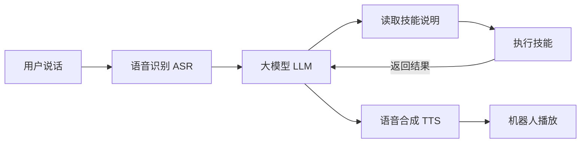

# 工作原理

一次语音交互大致经过以下流程：

框架先把可用技能的名称和简介交给大模型。模型需要某项能力时，再读取对应的 `SKILL.md`，执行其中描述的操作。技能的实际执行结果会返回模型，用于组织回复或继续下一步任务。

## 为什么这样划分职责

Buddy 管理技能发现、进程、资源和会话交接；技能管理自己的业务和向导。CLI 子进程边界使技能可以使用自己的依赖，并独立发布。安装向导入口由技能包声明，平台不需要知道点歌台的登录细节或游戏规则。

普通 task 完成后把结果交还 Buddy；独占游戏覆盖整局，在此期间 Buddy 暂停语音业务处理，游戏自己订阅原厂音频并执行自己的 ASR 和对话。Buddy 仍监督子进程和退出清理。这让游戏保持连续对话，也避免两个 Agent 同时理解一句话、同时答复。

协议版本与业务版本分离：顶层 `version: 0.1.0` 是技能发行版本，嵌套的 `primebuddy.version: 1` 是宿主接口契约。兼容的平台升级保留技能原版本；真正改变接口时通过新协议和迁移方案处理。

详见[音频流和状态机](audio-flow.md)、[技能运行协议](skill-protocol.md)、[安装向导协议](installation-protocol.md)、[升级与不兼容处理](upgrades.md)。

[返回文档导航](README.md) · [返回项目首页](../README.md)
