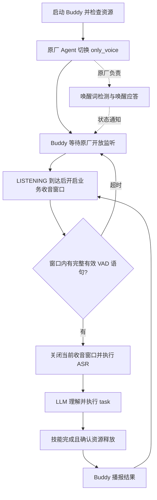
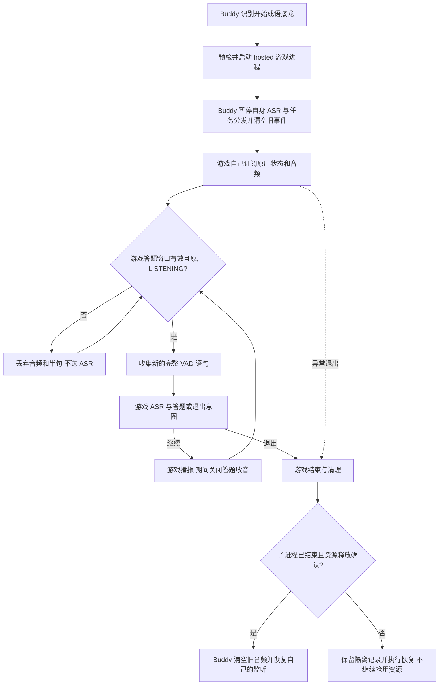

# only_voice 音频流程与设计原因

## 谁负责什么

Buddy 启动语音会话时管理原厂 Agent 的 `only_voice` 模式，退出时恢复原厂 Agent。原厂仍负责麦克风前端、唤醒词识别、唤醒应答和会话状态；业务语音由当前接管者送自己的 ASR，再由 Buddy 或游戏处理。`only_voice` 不表示原厂完全静音，也不表示唤醒词可以由 Buddy 拦截。

当前订阅两个 ROS topic：

| topic | 内容 | 用途 |
| --- | --- | --- |
| `/agent/process_audio_output` | 处理后的音频、stream_id、时间戳、VAD 边界 | 将有效窗口内的完整语句送 ASR |
| `/aima/agent/interaction_state` | 原厂会话状态，如 LISTENING、SPEAKING、IDLE | 判断监听时机，丢弃发声期间片段 |

**状态变化不等于明确的 wakeup 事件。** LISTENING 也可能来自播放结束，VAD 只表示语音边界。当前未验证到能够可靠区分“用户刚说了唤醒词”的独立通知，所以 Buddy 不凭状态或 VAD 取消 task。订阅一直存在也不等于所有音频都进入 ASR。

## 普通 task 的流程

Buddy 只有处于业务监听窗口时才拼接语句。自身播报、任务处理时不会持续把环境声音交给模型；已收到的过期包、缺少开始帧的残句不会作为新指令。原厂 SPEAKING 时清空半句并丢弃对应音频，避免把机器人自己的唤醒应答当作用户输入。

Buddy 的业务窗口默认 30 秒。这个计时是 Buddy 的策略，不能据此断言原厂一定在第 30 秒进入 IDLE。当前 Buddy 在 LISTENING 时打开窗口，窗口内明确屏蔽 SPEAKING；它的回调并非对每包都严格要求 `state == LISTENING`，这一点与下面游戏的严格门控不同。

唤醒词可能触发原厂应答，是否停止正在播放的原厂媒体由目标固件与播放器行为决定。`only_voice` 不能保证无抢播或无打断；当前没有通过提高系统音频优先级来压制原厂应答。游戏属于普通交互应用，不应抢占系统高优先级声音。

## 独占游戏的流程

“独占”是语音业务处理权独占。Buddy 没有退出或停止监督，它仍管理游戏进程、期限、取消及资源核验。游戏用 `play --hosted` 运行，不重复接管或恢复原厂模式；整场的 `only_voice` 生命周期由 Buddy 管理。

游戏自己选择何时接受答案。只有游戏答题窗口有效、原厂状态为 LISTENING、音频属于当前窗口，且具备完整 VAD 起止边界，才送 ASR。SPEAKING 和 IDLE 期间不送游戏 ASR，状态切换会丢弃半句，不把唤醒前后的声音拼成答案。

## 唤醒与 IDLE 的具体处理

| 场景 | 当前处理 | 用户操作 |
| --- | --- | --- |
| 游戏正在播报时说唤醒词 | 原厂可能应答；Buddy 不另开任务，游戏不接收 SPEAKING 片段 | 等机器人说完再回答 |
| 游戏等待回答且处于 LISTENING | 普通答案直接交给游戏，不要求每轮唤醒 | 直接说成语 |
| 原厂进入 IDLE | 游戏仍在运行，当前实现拒绝 IDLE 音频 | 说唤醒词，等应答结束，再说答案 |
| 连说“Q仔，Q仔，一马当先” | 不保证接收；跨应答状态的片段主动丢弃 | 分成唤醒和回答两步 |
| 用户长时间没回答 | 原厂 IDLE 不自动结束游戏；游戏独立执行静默退出规则 | 当前游戏约两分钟无回应后退出 |
| 游戏正常或异常退出 | Buddy 先确认进程及资源清理，再恢复业务监听 | 等待 Buddy 接管后的新一轮输入 |
| Buddy 退出 | 在清理后恢复原厂 normal 并核对状态，失败保留恢复记录 | 查看退出提示；不需要关机 |

区分“底层有没有音频包”和“应用是否接受答案”。IDLE 时当前游戏不会把包交给 ASR；不能把这一应用规则写成所有固件都绝不产生音频包。此前连续唤醒录音有能听见完整答案的片段，但用户实际说了两遍或更多，不能据此保证单次紧接唤醒的答案都能完整收到。产品因此统一采用“等唤醒应答结束再回答”。

## 为什么这样设计

1. 原厂保留硬件语音前端，减少对底层采音链路的重复实现。
2. SPEAKING 时不做业务识别，降低回声、自问自答和把原厂应答误当答案的概率。
3. 独占期间只有游戏解释用户语句，避免 Buddy 同时启动其他技能；用户退出游戏后才回到通用指令处理。
4. 不把 VAD 或状态跳变当作唤醒，避免普通回答、背景声音或播放结束误触发任务取消。
5. 错误留在技能进程边界内；资源未确认释放时继续隔离，而不是为了恢复对话强行抢用播放器或运动资源。

当前限制：明确的原厂 wakeup 通知与可靠的 task 语音打断仍待验证；真人语音回归尚未全部完成。状态枚举、话题时序与媒体行为都应按目标固件验收。

[返回文档导航](README.md) · [架构设计](architecture.md) · [技能运行协议](skill-protocol.md)
